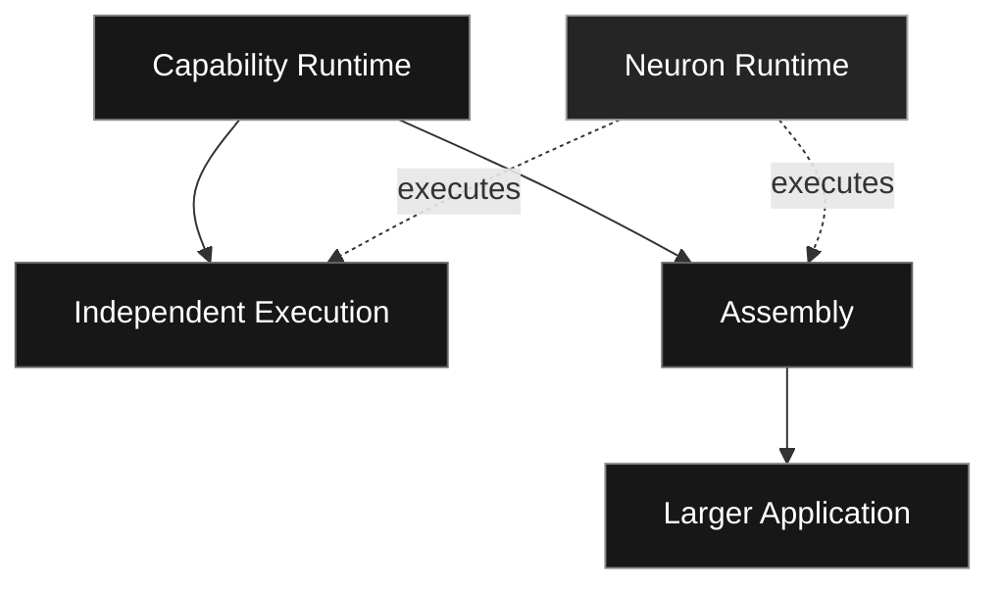

# Neuron

> **Run a project:** from a directory containing `neuron.config.*`, run `neuron`. The bare command builds and registers the project's declared Assemblies, then starts the foreground runtime. Use `neuron build` to build without starting the runtime.


A runtime for building and operating complex software systems from composable, executable capabilities.

Neuron composes software from capabilities connected by explicit relationships. The runtime schedules and executes those capabilities without needing to understand their business logic.

## What is Neuron

Neuron is built on three concepts.

A **capability** is an executable unit with a clear contract: it declares the params it accepts and the result it returns. A capability can be a native process, a WebAssembly module, an in-process built-in, or anything else that implements the capability runtime protocol.

An **assembly** declares which capabilities exist and how they connect, through explicit bindings and conditions. An assembly is the composition, not the implementation.

A **capability runtime** provides the machinery that runs capabilities. Neuron supports multiple runtime boundaries — process and WebAssembly today — so the composition stays independent of any single implementation technology.

Neuron is not a workflow engine. A workflow is one thing an assembly can represent. The core abstraction is composition: capabilities with explicit relationships.

## How it works



An assembly can be authored in any programming language that produces the Neuron Assembly manifest — the canonical representation every authoring surface converges on. Neuron ships two first-class authoring surfaces today, TypeScript and YAML, and a new language only needs to emit the canonical manifest.

At build time, Neuron compiles the manifest, resolves required external capability runtimes to exact versions, and freezes them. At run time, a project runtime executes the assembly according to the compiled plan and returns the assembly result. Because capabilities are reached through contracts, the physical location of a capability — in-process, a local worker, or a remote host — does not change the shape of the assembly.

A capability may suspend instead of completing: it declares a signal or timer wait, and a later invocation of the same logical operation resumes it with a delivery payload. This protocol extension is additive and feature-gated. Durable instances run a bounded, instance-scoped poll loop that resumes elapsed timer waits, expires execution deadlines, and reconciles ready dispatch intents; non-durable instances remain event-driven. A resumed or retried invocation carries a fresh attempt ID while the logical operation ID stays stable, so capability runtimes must deduplicate on the logical operation ID and delivery ID, never on the attempt ID. Instance CLI commands prefer a discovered live project runtime when no explicit remote is set. End-to-end restart and idempotency tests are implemented and pass, and the final Phase 5 validation gate (T-032) passed after T-081 (`./scripts/script.sh` printed `All modules built and tested successfully.`). See [Waiting and signals](./docs/ARCHITECTURE.md#waiting-and-signals).

## Why Neuron

The boundary Neuron introduces is between the definition of an assembly and the mechanisms that execute it.

Capabilities are reached through contracts, not through integration code that mixes implementation details into the composition. That keeps the runtime independent of any technology stack, lets a capability be implemented in whatever language or model fits it, and allows the same assembly to run entirely locally today and distribute individual capabilities later without redefining the logical architecture.

## Quick start

```bash
# Clone and run a minimal example
git clone https://github.com/neuron-runtime/neuron.git
cd neuron/examples/hello

# Build/register the assembly automatically and start the project runtime
neuron

# Run the assembly in another terminal
neuron run --params '{"name":"World"}'
```

## Documentation

- [Getting started](./docs/GETTING_STARTED.md)
- [Architecture](./docs/ARCHITECTURE.md)
- [Assemblies and capability runtimes](./docs/MODULES.md)
- [Installation](./docs/INSTALLATION.md)
- [TypeScript SDK](./packages/assembly-sdks/typescript/README.md)
- [Go capability runtime SDK](./packages/executor-sdks/golang/README.md)
- [.NET capability runtime SDK](./packages/executor-sdks/dotnet/README.md)
- [CLI reference](./application/README.md)

## Project status

Neuron is under active development. The core model — authoring, compilation, dependency freezing, project runtimes, capability runtimes, and providers — is implemented and exercised end to end. The surface is still evolving, so expect changes between releases.

## License

[MIT License](./LICENSE)
