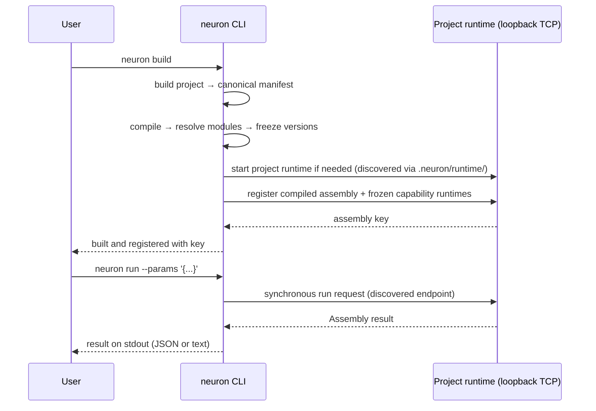

# Neuron Command Line Reference

The `neuron` CLI is the single user-facing interface to Neuron: author projects, build and register assemblies, manage capability runtimes and providers, and execute assemblies.

The CLI runs the Neuron runtime as needed. There is no global background daemon to manage in the normal workflow: each project has its own runtime endpoint (loopback TCP by default, `runtime.host` / `runtime.port` in the project config), and the CLI discovers it through the project's `.neuron/` state (for example `.neuron/runtime/`). You run commands; the runtime lifecycle follows the project.

Everything in the [command reference](#command-reference) is generated from the actual command definitions in this module (`application/cmd/neuron` and `application/internal/cli`), so it stays accurate as long as it is kept in sync with the code.



[Version](https://github.com/neuron-runtime/neuron/releases)
[Go](https://go.dev)
[License](../LICENSE)

---

## Table of Contents

- [Install & Verify](#install--verify)
- [Global Flags](#global-flags)
- [Command Reference](#command-reference)
- [Advanced](#advanced)
- [Configuration Reference](#configuration-reference)
- [Module Resolution](#module-resolution)
- [Building the CLI](#building-the-cli)

## Install & Verify

Neuron is distributed as a single archive containing the `neuron` CLI and the Neuron runtime. You only place `neuron` on your `PATH`.

```bash
neuron version
```

See [docs/INSTALLATION.md](../docs/INSTALLATION.md) for the full installation guide.

## Global Flags

The following flags are available on every `neuron` command.

| Flag                 | Description                                                      |
| -------------------- | ---------------------------------------------------------------- |
| `--config string`    | Project config file (one of `neuron.config.json` / `.yaml` / `.yml`; auto-discovered) |
| `--log-level string` | Logging level (default `"info"`)                                 |
| `-v, --verbose`      | Enable verbose output                                            |
| `--remote string`    | Remote Neuron runtime endpoint (e.g., `https://api.example.com`) |
| `--nore-path string` | Path to the runtime binary                                       |
| `--force`            | Force replacement (clear existing state before the command acts) |
| `-h, --help`         | Help for the command                                             |
| `--version`          | Print the CLI version and exit                                   |

## Command Reference

### `neuron version`

Print the Neuron CLI version.

```bash
neuron version
neuron --version
```

Both print the same version. The version is injected at build time from the release tag; a development build reports `dev`.

### `neuron init`

Initialize a new Neuron workspace.

```
Usage:
  neuron init [Target] [flags]

Flags:
  -l, --lang string   project authoring language (ts, typescript, yaml, yml) (default "ts")
```

`Target` is the directory to create (relative to the current directory). `neuron init` creates the directory and scaffolds a runnable project: a `neuron.config.json`, and — for the default TypeScript authoring surface — a `package.json` declaring `@neuronruntime/sdk`, a `tsconfig.json`, a starter `assembly.ts`, and the canonical local capability runtime root `neuron/capabilityRuntimes/`.

```bash
# Create ./my-assembly as a TypeScript project (default)
neuron init my-assembly

# Create ./my-assembly as a YAML project
neuron init my-assembly --lang yaml
```

The scaffolded config declares the project identity (`name` / `version`, which must match the authored Assembly metadata), the authoring language and entry file, and the loopback runtime endpoint:

```json
{
  "name": "my-assembly",
  "version": "1.0.0",
  "lang": "typescript",
  "entry": "assembly.ts",
  "runtime": {
    "host": "localhost",
    "port": "auto",
    "execution": { "mode": "wait", "timeout": "30m" }
  },
  "capabilityRuntimes": { "localRoots": ["./neuron/capabilityRuntimes"] },
  "inspector": { "enabled": true, "address": "127.0.0.1:7433" }
}
```

### `neuron build`

Build the current project and register the assembly with the runtime.

```
Usage:
  neuron build [flags]

Flags:
  -l, --lang string   project authoring language (yaml, yml, typescript, ts)
  -r, --root string   project root (defaults to the current directory)
```

`neuron build` runs the full authoring pipeline in one step. The project configuration must declare the Assembly identity (`name` and `version`): the build fails with a clear error when either is missing, or when either disagrees with the authored Assembly metadata.

| Step         | Responsibility                                                                                                                                                                                                                             |
| ------------ | ------------------------------------------------------------------------------------------------------------------------------------------------------------------------------------------------------------------------------------------ |
| **Build**    | The project (YAML or TypeScript) is resolved into the canonical `.neuron/manifest.json`                                                                                                                                                    |
| **Compile**  | The canonical manifest is compiled into a runtime assembly representation                                                                                                                                                                   |
| **Resolve**  | External module requirements are resolved through the configured registries, installed into the local store, and the exact versions are frozen into the build record. Built-in modules are skipped — they run in-process inside the Neuron runtime |
| **Register** | The compiled assembly and its frozen module set are registered with the runtime, which persists it and returns an assembly key                                                                                                               |

The CLI records the registration key in `.neuron/register.json` and prints it on success:

```text
order-processing@1.0.0#a1b2c3d4:development
```

```bash
# Build the project in the current directory (language auto-detected)
neuron build

# Force a language and a different project root
neuron build --lang typescript --root ./pipeline

# Replace any previously registered version of this assembly
neuron build --force
```

After the build, `neuron run` executes the registered assembly.

> `neuron register` is a deprecated alias of `neuron build`, hidden from help, kept for existing workflows. It will be removed.

### `neuron run`

Run a Neuron Assembly.

```
Usage:
  neuron run [instance-id|assembly-key] [flags]

Flags:
  -c, --capability-runtime string   run a Capability Runtime directly: a built-in core runtime (neuron:core:set) or an installed one (name[@version])
      --format string              Output format for the result (json, text) (default "json")
      --params string              JSON params payload for execution (e.g., '{"key":"value"}')
      --params-file string         Path to JSON file with params payload
      --port string                Override local runtime port (default: auto-discover from project)
      --remote string              Remote Neuron runtime endpoint (e.g., http://host:port)
```

`neuron run` is a client of the project runtime. It discovers the project's runtime endpoint (from `.neuron/` state or the project config), sends one synchronous execution request, and prints the Assembly result to stdout. It does not stream events or return execution handles — advanced execution inspection is exposed through the API rather than the normal `run` output.

The Assembly is addressed by the `assembly` selector on the request URL, never inside the params payload, so the same command works whether the runtime hosts one Assembly or many. Without an argument, `neuron run` uses the key of the current project build — the one `neuron build` recorded in `.neuron/current.json`. With a target argument it addresses that Assembly instead:

| Target form             | Example                             | Meaning                                  |
| ----------------------- | ----------------------------------- | ---------------------------------------- |
| Instance ID             | `inst_ab12cd`                       | Run the instance with that exact ID      |
| Key, colon form         | `order-processing:1.0.0`            | Run the assembly at that version         |
| Key, at form            | `order-processing@1.0.0`            | Same as the colon form                   |
| Bare name               | `order-processing`                  | Run the key's latest registered version  |

Remaining key segments (`:hash`, `:env`) are preserved as given. Instance IDs (`inst_*`) pass through unchanged; anything else is parsed as an assembly key and normalized to its colon-encoded wire form. When no argument is given and the project is not built, the command stops with a message pointing you at `neuron build`.

```bash
# Run the current project build with no params
neuron run

# Provide params inline
neuron run --params '{"order": {"id": "ord_123", "total": 4250, "currency": "USD"}}'

# Load params from a file
neuron run --params-file ./params.json

# Run the latest registered version of a named assembly
neuron run order-processing

# Emit the Assembly result as text instead of JSON
neuron run --format text
```

stdout contains only the Assembly result in the selected `--format`; logs, diagnostics, and execution errors go to stderr, and a failed or cancelled execution exits non-zero. The result comes from one synchronous request — the command does not stream events, expose execution handles, or list execution history.

#### Direct Capability Runtime invocation

With `-c` / `--capability-runtime`, `neuron run` executes a single Capability Runtime instead of an Assembly. Direct invocation needs no project, no build, and no running project runtime:

```bash
# A built-in core runtime, executed in-process by a one-shot local N.O.R.E. child
neuron run -c neuron:core:set --params '{"message":"hi"}'

# Legacy bare core names canonicalize to the neuron:core namespace
neuron run -c set --params '{"message":"hi"}'

# An installed capability runtime — exact pin or constraint
neuron run -c example:echo --params '{"message":"hi"}'
neuron run -c example:echo@1.0.0 --params '{"message":"hi"}'
```

Core runtimes (`set`, `ai`, `command`, `delay`, `http`, `log` under `neuron:core:`) are compiled into N.O.R.E. and are never installed, so they take no version — `neuron:core:set@1.0.0` is rejected — and resolve without touching the store. Installed artifacts resolve from the machine-global store only and are never fetched or installed implicitly. `--capability-runtime` cannot be combined with a target argument, `--remote`, or `--port`; the result prints to stdout in `--format` exactly as Assembly mode does.

Starting, observing, streaming, and cancelling executions remain available as advanced API operations: starting an execution (optionally detached), streaming its events, and cancelling a specific execution.

### `neuron add`

Resolve and install an external module (capability runtime) into the local store.

```
Usage:
  neuron add [name@version] [flags]
```

`name@version` selects an exact or constrained version (for example `example:echo` or `example:echo@^1.0.0`). Without a version, the best matching version is installed.

```bash
# Install the latest version
neuron add example:echo

# Install a specific version
neuron add example:echo@1.0.0

# Install a version that satisfies a constraint
neuron add example:echo@^1.0.0
```

Installed modules are stored immutably under the capability runtime store directory (`~/.neuron/capabilityRuntimes` by default). See [Module Resolution](#module-resolution) and [docs/MODULES.md](../docs/MODULES.md).

### `neuron remove`

Remove an installed external module (capability runtime).

```
Usage:
  neuron remove [name@version] [flags]
```

```bash
neuron remove example:echo@1.0.0
```

### `neuron builtins`

Report the capability runtimes N.O.R.E. provides without installation.

```
Usage:
  neuron builtins [name] [flags]

Flags:
  -v, --verbose   Include the full descriptions
```

A built-in capability runtime is part of the runtime: it is always available, it is never installed from a registry, and it is the capability runtime an assembly uses when it names none. The command reports the contract of every built-in, or the contract of one built-in when it is named. It needs neither a running runtime nor a project.

```bash
# List the built-in capability runtimes
neuron builtins

# The contract of one built-in
neuron builtins http

# The contract with the full descriptions
neuron builtins http --verbose
```

```
neuron:core:command     Runs a local program
neuron:core:filesystem  Reads files and directories
neuron:core:http        Makes an HTTP request
neuron:core:set         Materializes a capability's static value set
```

### `neuron capability runtime`

Inspect capability runtime packages installed in the local store. (Installing or removing a package is done with the top-level `neuron add` and `neuron remove` commands, since those change what a project pins.)

```
Usage:
  neuron capability runtime [flags]
  neuron capability runtime [command]

Available Commands:
  inspect     Inspect an installed capability runtime
  list        List installed capability runtimes
```

#### `neuron capability runtime list`

List installed capability runtimes.

```
Flags:
  -t, --type string   filter by capability runtime type
```

```bash
# List everything installed
neuron capability runtime list

# Only show capability runtimes of one type
neuron capability runtime list --type process
```

#### `neuron capability runtime inspect`

Inspect an installed capability runtime.

```
Usage:
  neuron capability runtime inspect [name@version] [flags]
```

```bash
neuron capability runtime inspect example:echo@1.0.0
```

### `neuron install`

Resolve, verify, and install a provider artifact into the machine-global provider store.

```
Usage:
  neuron install [flags]

Flags:
      --provider string    provider reference: name, name@version, or name@constraint
      --registry strings   registries allowed to satisfy the requirement (default: configured providers.defaultRegistries)
```

`--provider` selects an exact version (`--provider process@1.0.0`) or a constraint (`--provider process@^1.0.0`); without a version, the best available version is chosen. Providers are resolved through the configured registries (`github`, `local`), verified by content digest, and installed immutably into the machine-global provider store (`~/.neuron/providers` by default). The store layout is `<name>/<version>/<digest>/`.

```bash
# Install the latest version
neuron install --provider process

# Install a specific version
neuron install --provider process@1.0.0

# Restrict resolution to one registry
neuron install --provider process@^1.0.0 --registry local
```

```text
installed process@1.0.0 (a1b2c3d4e5f6a7b8, from local)
```

> [!NOTE]
> `neuron install` installs a **provider** — the host that supervises Capability Runtime artifacts — not a capability runtime. Capability runtimes are installed with `neuron add`. Omitting `--provider` fails with a message pointing you at `neuron add`.

### `neuron provider`

Manage first-party provider artifacts for local development.

```
Usage:
  neuron provider [flags]
  neuron provider [command]

Available Commands:
  build       Bootstrap descriptor-only first-party providers into the store
```

Providers obtained from a registry are installed with `neuron install --provider`. There is no `list`, `inspect`, or `remove` subcommand yet.

#### `neuron provider build`

Bootstrap descriptor-only first-party provider artifacts into the store.

```
Usage:
  neuron provider build [flags]

Flags:
  -o, --out string                override the target provider store root (defaults to providers.storeDir)
      --provider-version string   version assigned to the bootstrapped providers (default "0.1.0")
```

`neuron provider build` builds descriptor-only artifacts for the first-party providers `process` and `wasm` and installs them through the real installer. It performs **no** registry resolution and **no** download, and the artifacts carry no executable payload: each is a valid `provider.runtime.json` identity, so project builds and invocations resolve it exactly like a registry-installed provider. The install record marks every artifact with `source: bootstrap`, so a bootstrap install is never mistaken for a registry install.

```bash
# Install the first-party providers into the default provider store
neuron provider build

# Write them under a specific store root
neuron provider build --out /tmp/neuron-providers

# Assign a specific version
neuron provider build --provider-version 0.1.0
```

```text
bootstrap: process@0.1.0 (a1b2c3d4e5f6a7b8)
bootstrap: wasm@0.1.0 (b8a7f6e5d4c3b2a1)
bootstrap: providers available in /home/user/.neuron/providers
```

Rebuilding over an identical artifact reports `already present` instead of failing or duplicating.

### `neuron completion`

Generate the autocompletion script for your shell (bash, zsh, fish, or powershell).

```bash
# Example: install bash completion
source <(neuron completion bash)
```

## Advanced

The commands in this section are auxiliary. They are not part of the normal build-and-run flow.

### `neuron instance`

Create, list, and manage running assembly instances.

```
Usage:
  neuron instance [flags]
  neuron instance [command]

Available Commands:
  clear       Remove all instances and their executions and events
  list        List instances or executions of a specific instance
  remove      Remove an instance and its executions and events
```

An instance is a living realization of a registered assembly. `neuron run` creates one implicitly.

#### `neuron instance list`

List instances, or executions of a specific instance.

```
Usage:
  neuron instance list [instance-id] [flags]

Flags:
  -a, --all             List all instances including inactive ones
  -s, --status string   Filter instances by a specific status (e.g., running, stopped)
  -t, --target string   List executions of the instance with the given ID
```

```bash
# List all current instances
neuron instance list

# Show everything, including inactive instances
neuron instance list --all

# Filter by status
neuron instance list --status running

# List executions of one instance
neuron instance list --target <instance-id>
```

#### `neuron instance remove`

Remove an instance and its executions and events.

```
Usage:
  neuron instance remove [instance-id|assembly-key] [flags]

Aliases:
  remove, rm
```

```bash
neuron instance remove <instance-id>
neuron instance rm <instance-id>
```

#### `neuron instance clear`

Remove **all** instances and their executions and events.

```
Usage:
  neuron instance clear [flags]
```

```bash
neuron instance clear
```

### `neuron daemon`

Manage a Neuron runtime process directly.

```
Usage:
  neuron daemon [flags]
  neuron daemon [command]

Available Commands:
  stop        Stop a running Neuron runtime process
```

This command exists for environments where the runtime process must be managed explicitly. In the normal flow the CLI runs the runtime as needed per project; you do not need `neuron daemon` to build or run assemblies.

## Configuration Reference

The effective configuration is assembled from five layers, later layers overriding earlier ones:

1. Built-in defaults (compiled in).
2. The machine-level global configuration — `~/.config/neuron/config.yaml` (runtime defaults for this machine).
3. The project's `neuron.config.json` / `neuron.config.yaml` / `neuron.config.yml` (or the file passed with `--config`).
4. Environment variables (`NEURON_*`).
5. Command-line flags.

Project configuration is strict: unknown keys are rejected with an error, so a typo fails loudly instead of being silently ignored.

**The scaffolded** `neuron.config.json` **produced by** `neuron init` (default TypeScript authoring):

```json
{
  "name": "my-assembly",
  "version": "1.0.0",
  "lang": "typescript",
  "assemblies": [
    { "name": "my-assembly", "entry": "assembly.ts", "default": true }
  ],
  "runtime": {
    "host": "localhost",
    "port": "auto",
    "execution": {
      "mode": "wait",
      "timeout": "30m"
    }
  },
  "capabilityRuntimes": {
    "localRoots": ["./neuron/capabilityRuntimes"]
  },
  "inspector": {
    "enabled": true,
    "address": "127.0.0.1:7433"
  }
}
```

### Key configuration values

| Key                         | Default               | Meaning                                                                                                    |
| --------------------------- | --------------------- | ---------------------------------------------------------------------------------------------------------- |
| `name`                      | —                     | Assembly identity for this project; required for build, and must match the authored Assembly metadata        |
| `version`                   | —                     | Assembly semantic version; required for build, participates in Assembly identity and build hashing           |
| `lang`                      | `typescript`          | Project authoring language (`yaml`, `yml`, `typescript`, `ts`)                                             |
| `assemblies`                | —                     | Ordered list of Assembly declarations (`name`, `entry`, optional `default: true`). A project may define several; the one marked default (or the sole declaration) is what `neuron run` uses with no argument |
| `assemblies[].name`         | —                     | Assembly name; must be unique within the project                                                           |
| `assemblies[].entry`        | `index.ts` / `assembly.yaml` | Project-relative path to the Assembly definition (defaults: `index.ts` for TypeScript, `assembly.yaml` for YAML) |
| `assemblies[].default`      | `false`               | Marks the Assembly `neuron run` uses when no name is given; at most one may be `true`                       |
| `entry`                     | —                     | Legacy single-Assembly form, migrated to one `assemblies` declaration named after the project; rejected alongside `assemblies` |
| `variables`                 | —                     | Free-form variables carried into the compiled assembly manifest (e.g. environment-specific settings)        |
| `runtime.host`              | `localhost`           | Interface the project runtime binds to (loopback-first by default)                                         |
| `runtime.port`              | `auto`                | Project runtime port: `"auto"` (OS-assigned) or an explicit integer port                                   |
| `runtime.execution.mode`    | `wait`                | Execution mode (`wait` for a blocking result, `detach` for asynchronous)                                   |
| `runtime.execution.timeout` | `30m`                 | Execution timeout                                                                                          |
| `runtime.workers.min`       | `1`                   | Minimum capability runtime workers                                                                          |
| `runtime.workers.max`       | `8`                   | Maximum capability runtime workers                                                                          |
| `runtime.detachedDrainTimeout` | `30s`              | How long detached capability work may keep running after shutdown begins                                    |
| `capabilityRuntimes.localRoots` | `./neuron/capabilityRuntimes` | Project-scoped directories treated as implicit `local` registries for resolution                      |
| `capabilityRuntimes.registries` | none              | Registries used to resolve external modules; with no block, only built-in capability runtimes are available |
| `capabilityRuntimes.defaultRegistries` | `["local"]` | Registries a requirement falls back to when it declares none of its own                                |
| `providers.registries`      | none                  | Registries used to resolve provider artifacts; with no block, only the machine-global provider store and configured `local` roots are available |
| `providers.localRoots`      | none                  | Machine-global directories served by the `local` provider registry (no implicit project root)          |
| `providers.defaultRegistries` | `["local"]`         | Registries a provider requirement falls back to when it declares none of its own                        |
| `inspector.enabled`         | `true`                | Enable the runtime inspector                                                                               |
| `inspector.address`         | `127.0.0.1:7433`      | Inspector address                                                                                          |
| `dev.maxWorkers`            | `1`                   | How many capability runtime builds may run in parallel during `neuron build`                                |

> [!NOTE]
> Project configuration (`neuron.config.*`) rejects engine plumbing outright: runtime endpoint plumbing, storage provider/directory, and store directories (`capabilityRuntimes.storeDir`, `providers.storeDir`) are managed by Neuron, and unknown keys fail validation with an error. Address the runtime endpoint with `--remote` / `--nore-path` (or `NEURON_*` variables) instead.

### Environment variables

| Variable          | Meaning                                       |
| ----------------- | --------------------------------------------- |
| `NEURON_SOCKET`         | Override the runtime socket path              |
| `NEURON_DATA_DIR`       | Override the runtime data directory           |
| `NEURON_API_TOKEN`      | API token used to authenticate requests       |
| `NEURON_API_TOKEN_FILE` | Override the token file path                  |

Environment variables can also be used for any configuration value with the `NEURON_` prefix pattern (for example `NEURON_LOG_LEVEL`), and command-line flags always take precedence.

### Project layout

`neuron init <project>` scaffolds a **TypeScript** project by default: `neuron.config.json` (`name`, `version`, `lang: typescript`, `entry: assembly.ts`, `runtime.host` / `runtime.port`), `package.json`, `tsconfig.json`, `assembly.ts`, and `neuron/capabilityRuntimes/`. `neuron init <project> --lang yaml` scaffolds the canonical YAML layout instead (as shipped in `examples/ecommerce_order`):

```text
<project>
├── neuron.config.json   project configuration (name, version, lang, entry, runtime)
└── assembly.yaml        assembly definition (the entry file)
```

The assembly file lists its capabilities either by `entry:` reference or inline, and bindings are declared **inline** in the assembly file (mappings and validations) — there is no separate `bindings/` directory.

`neuron build` resolves this layout, produces the canonical manifest into `.neuron/manifest.json`, compiles it, and registers the result. The TypeScript authoring surface produces the same canonical manifest from SDK definitions.

## Module Resolution

When an assembly references an external module (for example `example:echo@1.0.0`), the CLI resolves it as follows:

1. **Requirement** — the assembly declares the module by logical name (`owner:path`) and optionally a version constraint.
2. **Resolution** — the configured registries are queried for available versions; the best matching version is chosen using semantic versioning (an empty constraint selects the latest version).
3. **Verification** — the selected package archive is verified (canonical archive `<name>-<version>-capability-runtime.neuron.tar.gz`, cryptographic digest).
4. **Installation** — the artifact is installed immutably into the capability runtime store.
5. **Freezing** — the exact resolved versions are frozen into the registered assembly, so the runtime can launch instances without resolving anything itself.

Built-in modules shipped inside the Neuron runtime are skipped during resolution; they run in-process. Everything else travels the resolution + installation + freezing path.

See [docs/MODULES.md](../docs/MODULES.md) for the complete module model and how to author a module.

## Building the CLI

From the repository root (a Go workspace):

```bash
go build -o neuron ./application/cmd/neuron
./neuron version
```

The release pipeline passes the release version through `-ldflags` so `neuron version` reports the exact release; see [scripts/release.sh](../scripts/release.sh).

## Related documentation

- **Getting started** — run your first assembly: [docs/GETTING_STARTED.md](../docs/GETTING_STARTED.md)
- **Installation** — official release and from-source installs: [docs/INSTALLATION.md](../docs/INSTALLATION.md)
- **Modules and capability runtimes** — the unified module model: [docs/MODULES.md](../docs/MODULES.md)
- **Architecture** — canonical pipeline, boundaries, and the runtime in depth: [docs/ARCHITECTURE.md](../docs/ARCHITECTURE.md)

## License

This application is part of Neuron, which is released under the MIT License. See [LICENSE](../LICENSE).
